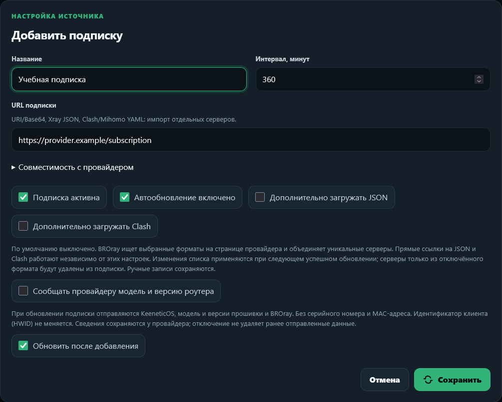
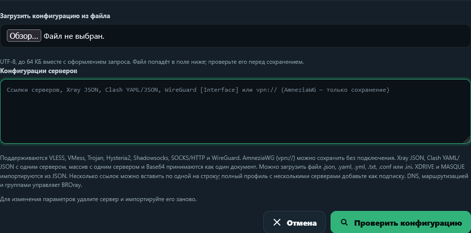
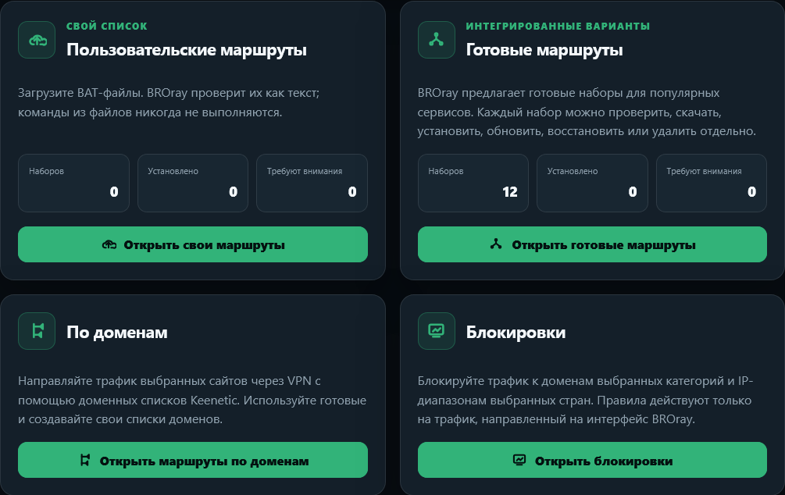
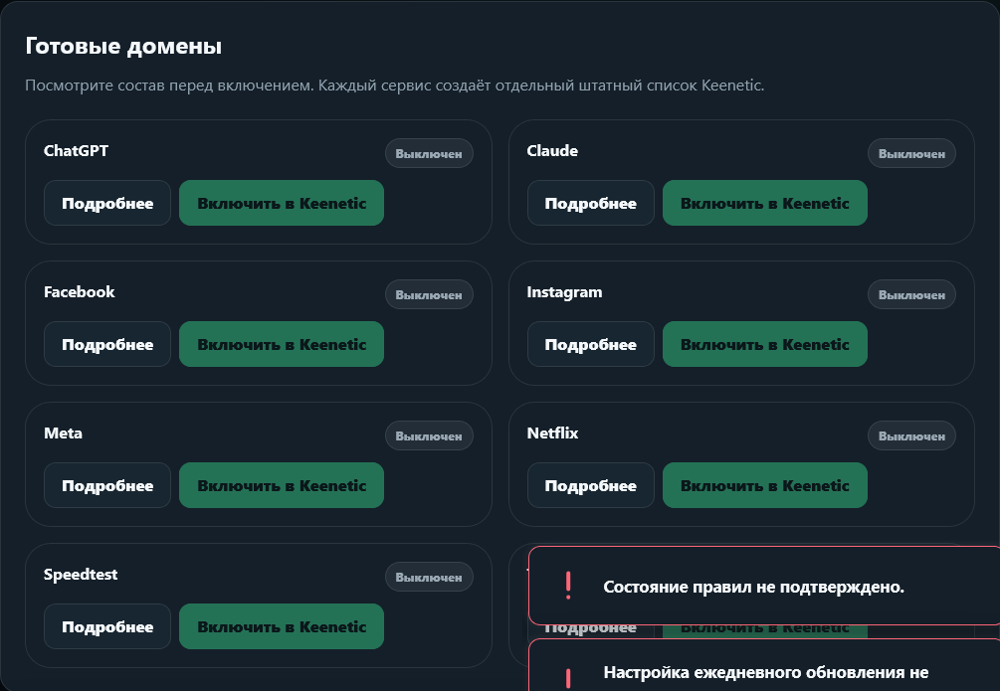
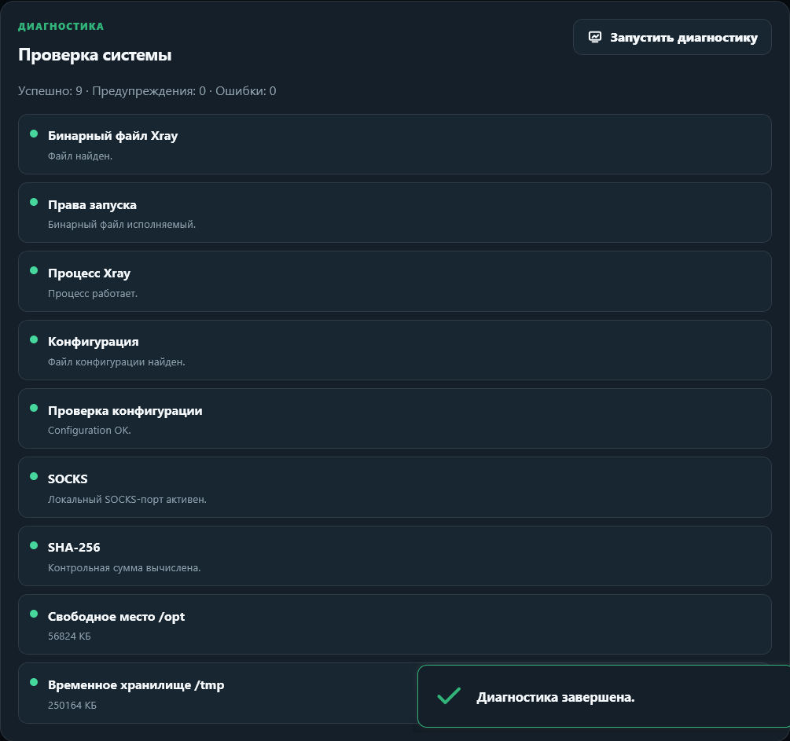

# BROray 3.5.9 — руководство пользователя

Руководство актуально для ревизии r9. Начните с первого подключения или откройте [справочник по страницам WebUI](#справочник-по-страницам-webui). [Версия руководства на сайте](https://docs.brovibe.cloud/broray/webui/).

## Вход и первый рабочий сервер

### 1. Откройте BROray

1. Подключите компьютер или телефон к домашнему Wi‑Fi либо к роутеру кабелем.
2. Откройте адрес BROray, который получили при установке. Например, `http://192.168.1.1:8080`. Адрес и порт в вашей сети могут быть другими.
3. Введите логин и пароль учётной записи Keenetic с доступом к BROray. На компьютере разделы доступны слева. На телефоне нажмите кнопку меню в левом верхнем углу.
4. На странице **Главная** можно увидеть, выбран ли сервер и отвечает ли VPN. Если серверов ещё нет, перейдите к следующему шагу.

**Если адрес открывает сам Keenetic:** проверьте адрес и порт BROray. У роутера и приложения свои панели управления. [Помощь с установкой и доступом](https://docs.brovibe.cloud/broray/start/)

### 2. Добавьте подписку или один сервер

**Подписка** — ссылка, по которой провайдер выдаёт и обновляет список серверов. **Конфигурация сервера** — ссылка URI или файл с параметрами подключения к конкретному серверу. Провайдер обычно сообщает, что именно он выдал.

#### Если у вас ссылка на подписку

1. Откройте **Подписки → Добавить подписку**.
2. Придумайте название для себя, например «Мой VPN». Вставьте ссылку провайдера в поле **URL подписки**.
3. Нажмите **Сохранить**. Если серверы ещё не появились, нажмите **Обновить** в карточке подписки и дождитесь результата.
4. Кнопка **Серверы** в карточке открывает серверы этой подписки. Если провайдер сообщил о проблеме или часть записей не принята, раскройте **Предупреждения обновления**.

*На рисунке учебная ссылка. Вставьте ссылку своего провайдера.*

Дополнительные флажки JSON и Clash пригодятся, когда провайдер публикует эти форматы на странице подписки. Если у вас обычная ссылка и серверы успешно загружаются, оставьте исходные настройки. При полном успешном обновлении BROray удаляет исчезнувшие серверы. Если исчез активный, BROray сначала проверяет замену среди серверов этой же обновлённой подписки. При удалении подписки удаляются её серверы.

#### Если у вас конфигурация одного сервера

1. Откройте **Серверы → Добавить сервер**.
2. Вставьте полученную ссылку или текст конфигурации. Файл можно загрузить через поле выше.
3. Нажмите **Проверить конфигурацию**. Посмотрите результат распознавания и подтвердите сохранение, если BROray предложит это сделать.
4. Вернитесь к блоку **Сохранённые серверы**.

Ссылки подписок, URI, файлы конфигураций и резервные копии могут содержать данные доступа. Храните их у себя и закрывайте такие поля на снимках экрана.

### 3. Проверьте сервер и подключитесь

1. На странице **Серверы** найдите нужную карточку. Если поле **Источник конфигурации** предлагает несколько вариантов, выберите тот, который дал провайдер. URI, JSON и Clash — названия форматов конфигурации.
2. Нажмите **Проверить** в карточке. Дождитесь результата. Статус **Доступен** означает, что BROray смог выполнить проверочный запрос через этот сервер.
3. Нажмите **Подключить**. Убедитесь, что выбранный сервер показан в верхней карточке как активный.
4. Откройте **Keenetic** в BROray и нажмите **Проверить подключение к Xray**. Так можно отдельно проверить связь роутера с программой, которая поднимает VPN.

Чтобы использовать VPN для выбранных сайтов, после подключения настройте маршруты. Трафик остальных сайтов определяется правилами вашего роутера.

## Маршруты — какие сайты и сети идут через VPN

Откройте **Маршруты → Обзор**. Выберите карточку исходя из того, что у вас есть и что вы хотите сделать.

| Задача | Раздел |
| --- | --- |
| Направить через VPN конкретный сайт или сервис | **По доменам** |
| Установить готовый набор IP-адресов или сетей | **Готовые маршруты** |
| Загрузить свой файл маршрутов с IP-адресами или сетями | **Свои маршруты** |
| Блокировать категории сайтов или IP-диапазоны стран для трафика через BROray | **Блокировки** |

### Готовые списки доменов

1. Откройте **Маршруты → По доменам**. В блоке **Готовые домены** сервисы расположены по алфавиту.
2. Нажмите **Подробнее**, чтобы посмотреть адреса. Если есть **Пропущенные правила**, раскройте их. Среди них могут быть правила для точного имени или шаблоны, которые Keenetic не может применить с тем же охватом.
3. Нажмите **Включить в Keenetic**, прочитайте состав и нажмите **Подтвердить включение**.
4. Дождитесь состояния **Включён**, затем попробуйте открыть сайт с устройства, подключённого к этому Keenetic. Для проверки устройству нужны DNS вашего Keenetic и соответствующая политика доступа, например **По умолчанию**.
5. Чтобы отменить действие, в той же карточке нажмите **Отключить** и подтвердите. Включённый список и его правило можно увидеть и в панели Keenetic, в разделе маршрутизации DNS. Название раздела зависит от прошивки.

### Свой список доменов

1. В блоке **Свои списки** нажмите **Добавить список**.
2. Дайте списку имя. Введите по одному домену на строку, например `example.org`. Вставляйте имя сайта без `https://`, пути и параметров.
3. Сохраните список. Чтобы он начал действовать, отдельно нажмите **Включить в Keenetic** и подтвердите.
4. Для изменения или удаления применённого списка сначала отключите его в Keenetic. Затем используйте **Редактировать** или **Удалить** на карточке.

Запись домена в Keenetic также охватывает его поддомены. Если нужен только один сайт внутри большого сервиса, вводите самый конкретный домен из адреса сайта. Для проверки отключите на клиенте отдельный DNS в браузере или системе, если он обходит DNS роутера.

### Маршруты по IP и блокировки

- В **Готовых маршрутах** выберите набор сервиса, посмотрите состав и установите нужный набор. IP-маршруты действуют по адресу назначения. Несколько сайтов могут использовать один IP.
- В **Своих маршрутах** можно загрузить свой BAT-файл со списком маршрутов. BROray читает его как текст и показывает результат проверки перед установкой. Команды файла не запускаются.
- В **Блокировках** можно выбрать категории доменов и IP-диапазоны стран. Эти правила действуют на трафик, направленный на интерфейс BROray. Прямой трафик мимо него продолжает идти по правилам Keenetic.
- Если используете IPv6, проверьте и IPv6-маршруты. Наличие IPv4-маршрута само по себе не направляет IPv6-трафик через VPN.

## Надёжность подключения

На странице **Серверы** доступны три разных действия.

| Возможность | Что делает |
| --- | --- |
| **Автоматическая проверка качества** | По расписанию измеряет доступность и качество сохранённых серверов. |
| **Автоматическое переключение** | Выбирает доступный сервер из общего списка по заданным условиям. |
| **Резервирование VPN** | Использует выбранный основной сервер и до двух резервных. |

Чтобы настроить резервирование, раскройте его карточку, выберите основной сервер и резерв, нажмите **Сохранить состав**, затем включите переключатель. Если под выбранным сервером показано поле «Источник конфигурации», укажите нужный профиль. Один сервер занимает одну позицию резерва. Для изменения состава сначала отключите резервирование. Если весь состав недоступен, BROray может временно выбрать рабочий сервер из общего списка по правилам автовыбора. После восстановления сервера из сохранённого состава BROray возвращается в резервную группу. В панели Keenetic имя интерфейса в этом режиме — `BROray - mix-auto`. Имя текущего сервера смотрите в BROray.

Опция **Обход DPI** есть в карточке профиля. Используйте её только там, где BROray подтверждает поддержку. Состояние и откат доступны в этом же блоке.

Кнопка **Удалить все, кроме активного** находится внизу страницы **Серверы**. Действие доступно при активном сервере и выключенном резервировании. Будут удалены и доступные, и недоступные записи, кроме него.

## DNS-over-TLS — защищённые запросы имён сайтов

DNS помогает роутеру узнать IP-адрес сайта по его имени. DNS-over-TLS шифрует запросы от Keenetic к выбранным DNS-серверам.

1. Откройте **DNS-over-TLS** и отметьте нужные серверы.
2. Нажмите **Проверить выбранные**. В карточке каждого сервера видно, прошли ли соединение, TLS и DNS-запрос.
3. После успешной проверки выбранных серверов нажмите **Установить в Keenetic**. Статус **Установлено** показывает, что конфигурация подтверждена в роутере.
4. Если нужно отменить настройку выбранных DoT-записей BROray, используйте **Удалить выбранные DoT-записи**.

Автоматическая проверка DNS измеряет доступность и обновляет результаты. Установка выбранной конфигурации выполняется отдельной кнопкой.

## Диагностика и обслуживание

- **Keenetic** — состояние связи между роутером и BROray. Для проверки UDP откройте карточку **Проверка UDP** и нажмите **Проверить UDP**.
- **Xray** — состояние программы, которая устанавливает VPN-соединение. **Проверить конфигурацию** проверяет настройки. **Запустить диагностику** показывает, запущен ли Xray, отвечает ли SOCKS и достаточно ли места.
- **BROray** — резервная копия, обновления, очередь и журнал. Чтобы понять, почему действие ещё не завершилось, проверьте очередь. Для событий откройте **Журнал BROray → Показать журнал**. Для обновления сначала скачайте резервную копию настроек.

### Если что-то не получилось

| Что вы видите | Что проверить |
| --- | --- |
| Подписка видна, серверов нет | Нажмите **Обновить**, дождитесь завершения и раскройте **Предупреждения обновления**. Сверьте ссылку с той, которую дал провайдер. |
| Сервер недоступен | Проверьте другой сохранённый сервер. Если недоступны все, проверьте интернет на роутере и состояние **Xray → Запустить диагностику**. |
| Сервер активен, сайт идёт мимо VPN | Проверьте состояние доменного списка, DNS клиента, политику доступа и IPv6. Затем проверьте связь в разделе **Keenetic**. |
| Операция ожидает выполнения | Посмотрите очередь на странице **BROray**. Дождитесь завершения принятой операции перед повторным нажатием. |
| После обновления открывается экран входа | Войдите снова под своей учётной записью Keenetic. |

Снимки сделаны из интерфейса 3.5.9 на учебных данных. Названия серверов и состояния на вашем роутере будут отличаться.

## Справочник по страницам WebUI

### Вход и навигация

Подключитесь к роутеру и откройте адрес BROray, указанный при установке. Для локального входа это обычно адрес Keenetic с портом 8080, например `http://192.168.1.1:8080`. Используйте логин и пароль администратора Keenetic. После перезапуска или обновления BROray войдите снова.

На компьютере меню находится слева. На телефоне откройте его кнопкой в левом верхнем углу. В шапке можно сменить тему. Выбор темы сохраняется в браузере. Для выхода воспользуйтесь кнопкой **Выйти** в меню.

**Вход на KeeneticOS 5.2 через NDW4.** Для этого механизма требуется пароль администратора длиной от восьми символов. При необходимости смените его в разделе «Пользователи и доступ» самого Keenetic. [Что проверить при ошибках входа 502 и 503](https://docs.brovibe.cloud/broray/troubleshooting/#keeneticos-52-short-password).

Для доступа по внешнему адресу сначала [настройте публикацию через KeenDNS](https://docs.brovibe.cloud/broray/start/#remote-webui). Если после обновления браузер показывает старый интерфейс, [обновите страницу без кеша](https://docs.brovibe.cloud/broray/troubleshooting/#stale-cache).

### Главная

Проверьте состояние активного сервера, последнюю проверку качества и состояние Xray. Здесь же видны сводки по подпискам, DNS-over-TLS, маршрутам, интерфейсу Keenetic и самому BROray. Откройте нужный раздел для настройки или диагностики. Обратите внимание на время проверки, если приложение сообщает, что данные устарели.

### Серверы

#### Добавьте сервер и проверьте соединение

- **Добавить сервер.** Вставьте URI, клиентскую конфигурацию WireGuard, Xray JSON или Clash/Mihomo YAML либо JSON. Поддерживаемый документ можно загрузить как файл UTF-8. Перед сохранением нажмите **Проверить конфигурацию** и прочитайте предупреждения. Несколько отдельных URI можно вставить строками. Ручной импорт структурированного документа рассчитан на один узел. Для списка провайдера используйте страницу «Подписки».
- **Источник конфигурации.** В одной карточке одинакового сервера могут быть варианты из разных источников. Выберите нужный профиль по названию подписки и формату URI, JSON или Clash. Проверка, подключение и настройки **Обход DPI** относятся к выбранному профилю.
- **Проверить** в карточке запускает проверочный HTTPS-запрос через выбранный сервер. Затем нажмите **Подключить** и проверьте, что сервер появился в верхней карточке. Проверка активного подключения подтверждает связь и отдельно обновляет измерения качества. Пинг и давность проверки помогают сопоставлять результаты.
- **Удалить все, кроме активного** находится внизу страницы. Действие доступно при активном сервере и выключенном резервировании. Удаляются все другие сохранённые серверы, включая доступные. Серверы провайдера могут появиться снова при следующем обновлении подписки.

#### Настройте автоматическую работу

- **Автоматическая проверка качества** по расписанию проверяет сохранённые серверы, даже когда страница закрыта. Для начала можно выбрать интервал 30 минут, 1, 3 или 6 часов.
- **Автоматическое переключение** ищет доступный сервер в общем списке по выбранному правилу. Можно ориентироваться на качество, меньший пинг или предпочитаемый сервер. Ручное подключение в обычном режиме выключает автоматическое переключение.
- **Резервирование VPN** использует основной сервер, первый резерв и при необходимости второй. Выберите нужный **Источник конфигурации**, нажмите **Сохранить состав** и включите резервирование. Для редактирования состава через поля выключите резервирование. Состав и текущее подключение при выключении сохраняются.

При отказе активного сервера BROray проверяет резервные. Если весь состав недоступен, приложение может временно подключить проверенный сервер из общего списка по правилам автовыбора. Как только сервер из состава снова доступен и выполнены условия возврата, BROray возвращается в сохранённый состав. Имя интерфейса в Keenetic остаётся `BROray - mix-auto` всё время, пока включено резервирование. Текущий сервер виден на странице «Серверы».

В обычном цикле связь проверяется каждые 15 секунд, переключение происходит после трёх неудачных проверок. При обычном возврате с резерва на основной нужны три успешные проверки и минимум десять минут с момента переключения.

Если при включённом резервировании выбрать сервер вне состава, карточка подключения предложит **Сделать основным** или **Отключить резервирование и подключить**. При заполненном составе для первого действия выберите, кого исключить. Если карточка сообщает о сбое, нажмите **Восстановить резервирование**. Временное рабочее соединение сохраняется, если проверка не нашла доступного сервера из сохранённого состава.

#### Обход DPI

Используйте блок **Обход DPI** в карточке нужного профиля. Возможность зависит от транспорта и параметров TLS или REALITY. Если профиль не поддерживается, карточка это показывает. При изменении дождитесь завершения операции. Здесь же доступна команда **Проверить состояние**. Если применение не проходит проверку, BROray пытается вернуть предыдущую конфигурацию.

### Подписки

- **Добавить подписку** сохраняет название и ссылку провайдера. Поддерживаются списки URI и Base64, Xray JSON, Clash/Mihomo и другие совместимые клиентские форматы. Кнопка **Обновить** загружает актуальные серверы, **Серверы** открывает их список, **Изменить** меняет параметры подписки.
- Активность подписки и автообновление настраиваются отдельно. В карточке видны интервал, последнее и следующее обновление, число принятых, изменённых и удалённых записей. Если провайдер передал остаток трафика, срок или ссылки, раскройте **Сведения провайдера**. Ошибки и неполные выгрузки описаны в **Предупреждениях обновления**.
- При полном успешном обновлении BROray удаляет серверы, исчезнувшие из этой подписки. Если исчез активный, приложение сначала проверяет замену среди серверов обновлённой подписки. Когда безопасной замены нет, прежнее подключение может сохраняться. Пустой, повреждённый или частичный ответ сам по себе не даёт основания удалять прежние серверы.
- **Удалить** в карточке подписки удаляет подписку вместе с её серверами. Если мешает активное подключение или сохранённый состав резервирования, BROray покажет причину. Переключите подключение или измените состав в соответствии с сообщением, затем повторите действие.

[Поддерживаемые форматы и ограничения импорта](https://docs.brovibe.cloud/broray/reference/#protocols).

#### Одна подписка: URI, JSON и Clash

Если провайдер объявляет дополнительные экспорты той же подписки, откройте её настройки и включите **Дополнительно загружать JSON** или **Дополнительно загружать Clash**. Оба переключателя по умолчанию выключены. Прямой URL формата можно добавить как отдельную подписку независимо от этих настроек.

#### Как обновляются дополнительные форматы

Нажмите **Обновить** после изменения настроек. Полные совпадения объединяются, различающиеся профили остаются доступны в выборе источника. После полного успешного обновления профили отключённого дополнительного формата могут исчезнуть из подписки. При ошибке получения или разбора включённой выгрузки прежний список сохраняется. Из конфигурации провайдера импортируются поддерживаемые серверы. DNS, маршруты и прокси-группы полного профиля не применяются как настройки BROray. Если основная ссылка отдаёт только HTML, включите подходящий объявленный провайдером формат или укажите прямую ссылку на конфигурацию.

#### Ограничения отдельных форматов

Профили в режиме **Только сохранение** остаются доступны для просмотра. Пример такого профиля — AmneziaWG. Для поддерживаемых конфигураций XDRIVE/MASQUE нужно ядро Xray 26.11.9 или совместимое более новое. Предупреждения для конкретного сервера открываются через **Подробнее → Предупреждения конфигурации**. [Ограничения отдельных форматов](https://docs.brovibe.cloud/broray/reference/#limitations-353).

### DNS-over-TLS

DNS помогает узнать IP-адрес сайта по его имени. DNS-over-TLS шифрует запросы от Keenetic к выбранным DNS-серверам.

1. Отметьте нужные серверы IPv4 или IPv6. Лимит — восемь явных записей DoT/DoH в Keenetic, включая уже установленные внешние записи.
2. Нажмите **Проверить выбранные**. Для каждого сервера BROray проверит соединение, TLS-сертификат и ответ DNS. Возможность применения IPv6 зависит от Keenetic.
3. После успешной проверки нажмите **Установить в Keenetic**. Сверьте статус и фактическое наличие записей. Автоматическая проверка обновляет результаты каждые пять минут. Установка выполняется отдельной командой.
4. Чтобы удалить записи, которыми управляет BROray, выберите их, нажмите **Удалить выбранные DoT-записи** и проверьте список в подтверждении.

#### DNS встроенных фильтров

В технических сведениях видны внешние настройки DoT/DoH и отдельно DNS встроенных фильтров Keenetic. BROray изменяет только принадлежащие ему записи.

### Маршруты → Обзор

Откройте **Маршруты → Обзор** и выберите раздел по задаче. Здесь видны установленные наборы и предупреждение, если включён IPv6 и трафик может идти мимо IPv4-маршрутов. При установке маршрутов следите за прогрессом операции. Остановка и продолжение доступны на этапах, в которых интерфейс предлагает соответствующее действие.

#### Свои маршруты

Загрузите BAT-файл с IP-адресами и сетями. BROray читает его как текст и показывает предварительный результат. Команды из файла не выполняются. Сверьте адреса и семейства IPv4/IPv6, затем установите набор в Keenetic. Карточка позволяет обновить или восстановить маршрут, убрать его из Keenetic либо удалить сохранённый набор.

#### Готовые маршруты

Выберите сервис, скачайте набор, проверьте состав и установите его в Keenetic. IP-маршруты направляют трафик по адресу назначения. Каталог включает ChatGPT, Claude, Facebook, Instagram, Meta, Netflix, Speedtest, Telegram, TikTok, WhatsApp, Wikipedia и YouTube. Состав IP-адресов может меняться. Проверку обновлений можно запланировать. Автоматическое применение включается отдельно и использует защиту от удаления слишком большой части маршрутов.

#### По доменам

Используйте готовые списки сервисов или создавайте свои. В своём списке укажите по одному имени на строку, например `example.org`, без протокола, пути и параметров. Сохранение списка оставляет его в BROray до отдельного применения.

1. В карточке откройте **Подробнее**. Сверьте совместимые домены и причины пропуска правил. Keenetic включает указанное имя и его поддомены. Поэтому правила только для точного имени или регулярные выражения, которые нельзя перенести с тем же охватом, пропускаются.
2. Нажмите **Включить в Keenetic**, затем **Подтвердить включение**. BROray создаёт в Keenetic отдельный доменный список и правило маршрутизации через интерфейс BROray. После подтверждения появляется статус **Включён**.
3. Проверьте сайт с устройства, подключённого к этому Keenetic, с DNS роутера и политикой **По умолчанию**. Если браузер или устройство использует свой DNS, запрос может миновать доменную маршрутизацию роутера.
4. **Отключить** удаляет из Keenetic управляемый список и правило, сохраняя сам список в BROray. Для правки применённого своего списка сначала отключите его. Если карточка требует восстановления, воспользуйтесь предложенным действием и снова сверьте статус.

#### Блокировки

Правила применяются только к трафику, направленному на интерфейс BROray. Выберите категорию доменов GeoSite или IP-диапазоны страны GeoIP, затем задайте действие **Блокировать** или **Напрямую**. Первое запрещает совпавший трафик, второе отправляет его напрямую, минуя VPN. Новое правило нужно включить. Базы GeoSite и GeoIP можно обновлять вручную или по расписанию.

### Keenetic

Здесь виден интерфейс BROray в Keenetic и его связь с Xray. BROray управляет выделенным SOCKS-интерфейсом ProxyN. При проблеме карточка показывает состояние и доступные действия, в том числе настройку, восстановление или синхронизацию.

- **Проверить подключение к Xray** проверяет связь Keenetic с локальным Xray.
- **Проверить UDP** находится в карточке **Проверка UDP**. По результату видно, подтверждён ли проход UDP, и какой внешний адрес удалось определить. Если контрольные серверы не ответили, проверка не подтверждает UDP.
- В блоке **KeenDNS** можно включить отдельный внешний адрес WebUI вида `broray.<домен>`, открыть или скопировать его. После изменения дождитесь результата операции.

### Xray

Xray устанавливает соединение с VPN-сервером. На этой странице можно запустить, остановить или перезапустить ядро, **Проверить конфигурацию** и **Запустить диагностику**. Диагностика показывает состояние процесса, конфигурации, SOCKS-порта, контрольной суммы и места в хранилищах.

#### Обслуживание ядра

Можно установить совместимую официальную версию ядра или переустановить текущую. Проверьте архитектуру роутера и отметку совместимости. Для предварительной версии или понижения версии интерфейс выводит отдельное подтверждение. При нехватке места интерфейс может предложить установку с временной копией в RAM. Удаление Xray оставляет настройки BROray, но VPN требует повторной установки ядра. [Обслуживание Xray по шагам](https://docs.brovibe.cloud/broray/maintenance/#xray-maintenance).

### BROray

- **Обновление приложения.** Нажмите **Проверить обновление**. Для поддерживаемой более ранней версии 3.5.x WebUI предложит **Установить обновление**. Если у вас уже 3.5.9 и WebUI предлагает текущий выпуск Stable, используйте **Переустановить текущую версию** для установки актуальной ревизии r9.
- **Безопасная очистка.** Нажмите **Проверить очистку**, посмотрите список и объём, затем подтвердите **Очистить**, пока результат проверки действителен. BROray сохраняет активную версию, последнюю версию для отката и защищённые копии. Одинаковые файлы GeoIP и GeoSite могут храниться в одном экземпляре с сохранением истории отката.
- **Резервная копия настроек.** Скачайте копию перед обновлением или переносом настроек. Для файла можно задать пароль. Перед восстановлением загрузите файл и прочитайте предварительный результат. Отмена импорта доступна, когда сохранена предыдущая проверенная копия.
- **Операции и журнал.** В очереди видны ожидающие, выполняемые и завершённые задания. Если операция ожидает выполнения, проверьте очередь перед повторным нажатием. Фоновую работу можно остановить и возобновить. Чтобы посмотреть события, откройте **Журнал BROray → Показать журнал**. При необходимости скачайте диагностический отчёт.
- **Удаление BROray.** Доступно при входе по локальному IPv4-адресу роутера. Обычное удаление сохраняет резервную копию пользовательских данных. Полное удаление убирает также управляемые настройки и данные BROray.

[Обслуживание по шагам](https://docs.brovibe.cloud/broray/maintenance/).
